<h1 align="center">Tim Witter</h1>

  <strong>Agent harnesses · Linux systems · networks</strong> 
  Independent engineer in Vienna

  <a href="https://timwitter.com/en/">timwitter.com</a>
  &nbsp;·&nbsp;
  <a href="https://timwitter.com/en/blog/">Writing</a>
  &nbsp;·&nbsp;
  <a href="mailto:hello@timwitter.com">hello@timwitter.com</a>

---

I build AI agents and the systems around them:

- **Agents and their tools:** harnesses, skills, code navigation and memory for coding agents.
- **The environments they run in:** NixOS hosts, isolated runtimes, routing, firewalls and controlled egress.
- **Checks on their work:** reproducible tasks, with results checked by a separate evaluator.

<picture>
  <source media="(max-width: 600px)" srcset="./assets/agent-harness-narrow.svg" />
  
</picture>

Illustration, not a recording or a result. The mark is the <a href="https://github.com/timfewi/tentaflake">Tentaflake</a> logo and stands for the harness here. No scores or rankings are shown.

One task from a private benchmark I use to compare agent harnesses: **repair routing and firewall.** The agent investigates an isolated Linux network and submits a corrected configuration. A separate evaluator then checks the result from outside the agent's run: one service must be reachable, another must stay blocked.

## Selected projects

**Where agents run**

- [Tentaflake](https://github.com/timfewi/tentaflake): NixOS flake for isolated AI agents on one host, declared in one TOML file and managed through systemd and a Rust CLI. Pre-1.0. [Docs](https://docs.tentaflake.dev/)
- [tentaflake-research](https://github.com/timfewi/tentaflake-research): isolated public web research for agents; the NixOS firewall restricts its egress to a VPN. Experimental.

**How agents find their way**

- [unix-agent-skills](https://github.com/timfewi/unix-agent-skills): small, single-purpose Agent Skills for coding agents on Linux and macOS.
- [ast-index-nix](https://github.com/timfewi/ast-index-nix): local AST code index with callers, callees and impact over MCP or a JSON CLI. Ambiguous names stay unresolved instead of guessed.
- [Tabula](https://github.com/timfewi/tabula-repo): short repository guides linked to source. `tabula check` reports the explanations whose files changed.
- [Ichnora](https://github.com/timfewi/ichnora): project-scoped memory with provenance, so a later session can tell current evidence from stale history.

**Verification and operations**

- [project-check](https://github.com/timfewi/project-check): argv-only verification runner. One `.project-checks.json` per repository, `fast` and `full` profiles, and `--plan` to inspect checks without running them.
- [shell-away](https://github.com/timfewi/shell-away): temporary, adapted shell on an SSH or Tailscale SSH target, with nothing installed there.

## Contact

Scoped projects or ongoing support for teams building agent systems and the Linux and network infrastructure under them.

<a href="mailto:hello@timwitter.com"><strong>hello@timwitter.com</strong></a> · <a href="https://timwitter.com/en/">timwitter.com</a> · Vienna · remote
