<h1 align="center">Tim Witter</h1>

  <strong>AI systems on solid infrastructure.</strong> 
  Independent engineer in Vienna · AI, infrastructure &amp; security

  <a href="https://timwitter.com/">timwitter.com</a>
  &nbsp;·&nbsp;
  <a href="https://timwitter.com/blog/">Writing</a>
  &nbsp;·&nbsp;
  <a href="mailto:hello@timwitter.com">hello@timwitter.com</a>

---

I design and build AI and agent systems, reproducible Linux and NixOS infrastructure, and the network and security layers around them — for developer teams, startups and anyone working on hard technical problems.

**Agents on top, infrastructure underneath:** agents that run safely, hosts that can be rebuilt from a file, and networks that only allow what they should.

| AI & agent systems | Linux & NixOS | Network & security | Software & tooling |
| --- | --- | --- | --- |
| Agent workflows · isolated runtimes · tool & model gateways | NixOS hosts & flakes · MicroVMs & containers · automation | Threat models · egress & segmentation · secrets & access | CLIs, services, terminal UIs and APIs in Rust, Go & Python |

## What I'm building

### [Tentaflake](https://github.com/timfewi/tentaflake) — agents that keep running, declared with NixOS

<picture>
  <source media="(prefers-color-scheme: dark)" srcset="./assets/agent-office-dark.svg" />
  
</picture>

Hermes and ZeroClaw are supported, OpenClaw is a scaffold. An illustration of agents at work in a Tentaflake environment, not a live view.

A NixOS tool that keeps AI agents running around the clock on a headless Linux machine. Each agent lives in its own isolated container, declared in a flake — Tentaflake is the environment around them all.

- **Declarative** — hosts, agents and their runtimes are configuration you can review, rebuild and roll back.
- **Isolated** — a capsule per agent with its own secrets, skills and persistent workspace. No direct network access by default; models and the web are reached through policy.
- **Always on** — headless and 24/7 under systemd, with a Rust broker and operator CLI. Unattended start requires the agent's policy boundaries to be in place.

> Autonomy should increase capability, not implicit authority.

`NixOS` · `Rust` · `OCI containers` · `systemd` · `pre-1.0`

[Repository](https://github.com/timfewi/tentaflake) · [Documentation](https://docs.tentaflake.dev/) · [tentaflake.dev](https://tentaflake.dev/)

## Tools for agent-assisted engineering

Tentaflake runs the agents; these tools shape how they work. Each one is small, local-first, packaged with Nix and usable from Claude Code, Codex, OpenCode or the shell — built for and used on my own NixOS workstation. Together they form a loop: **guide** the agent, **navigate** the code and **verify** the change.

### [unix-agent-skills](https://github.com/timfewi/unix-agent-skills)

**Small, isolated Agent Skills for coding agents on Linux and macOS.**

Each skill does one job, stands alone and is short enough to load whole — across `agent/`, `code/`, `vcs/`, `security/` and `system/`: `tool-use`, `filesystem-wizard`, `fast-checks`, `finalize-loop`, `process-debugging`, `portable-shell` and more.

- Written for bash and zsh, GNU and BSD userlands.
- Every `SKILL.md` stays under 400 words; routing cases cover positive, negative and ambiguous requests.
- Install with Nix (`lib.skills`) or by linking the skill directories into your harness.

`Agent Skills` · `Claude Code` · `Codex` · `OpenCode` · `Nix` — related: [Skills belong at the moment of need](https://timwitter.com/blog/skills-at-the-moment-of-need/)

### [ast-index-nix](https://github.com/timfewi/ast-index-nix)

**Local-first AST code index — structural answers with honest unknowns.**

Tree-sitter extracts definitions, call sites, imports and SQL dependencies into one SQLite file. Agents search, outline, follow callers and callees and estimate impact through a single MCP tool (`code_explore`), a `--json` CLI or a shared Unix-socket service.

- Rust, Python, TypeScript/TSX, JavaScript, Nix, Bash, Go, Lua and PostgreSQL.
- Precision first: an ambiguous name stays unresolved instead of being guessed.
- No network, no telemetry, no LLM dependency.

`Rust` · `tree-sitter` · `SQLite` · `MCP` — related: [Structural navigation with honest unknowns](https://timwitter.com/blog/structural-navigation-with-honest-unknowns/)

### [project-check-nix](https://github.com/timfewi/project-check-nix)

**Argv-only verification runner — one manifest per repository, no shell evaluation.**

`project-check` reads `.project-checks.json` and runs pinned commands in `baseline`, `fast`, `full` and `watch` profiles, with `--json` reports for agents and CI.

- `--plan` shows the selected checks and missing prerequisites without running anything; `--changed` marks which checks a change affects and never skips one.
- Zero findings are not proof of coverage: a run without supported sources or with parser errors never reports `passed`.
- The bundled `project-docs` refreshes declared Markdown from templates, with versions read from lockfiles and manifests.

`Python` · `Nix` — related: [Verification is a project contract](https://timwitter.com/blog/verification-as-a-project-contract/)

## More projects

- **[visual-qa-mcp](https://github.com/timfewi/visual-qa-mcp)** — MCP server for evidence-backed visual QA: inspect a running UI, fix one thing, recheck only what the fix could affect. `TypeScript` · `Playwright` · `MCP`

## About

Hi, I'm Tim — an independent engineer in Vienna. I like systems with clear boundaries: where an agent may act, what a host may trust, what a network should allow. I start with the requirements, the existing code and the people working with it, explain trade-offs, and aim for software that stays understandable after handover.

`declarative over implicit` · `capabilities over ambient authority` · `evidence over claims`

`Rust` · `Go` · `Python` · `TypeScript` · `Bash` · `Linux` · `NixOS` · `systemd` · `Tailscale`

## Let's talk

Scoped projects, hourly support, or part of your team — for developer teams, startups and anyone building technically demanding systems. Tell me what you need and your timeline; for a technical question, a short description and some context are enough.

  <a href="mailto:hello@timwitter.com"><strong>hello@timwitter.com</strong></a>
  &nbsp;·&nbsp;
  <a href="https://timwitter.com/">timwitter.com</a>
  &nbsp;·&nbsp;
  Vienna · remote worldwide

